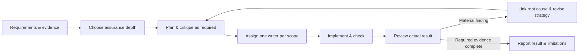

<div align="center">

# MAS1

**Give AI agents a workflow worth trusting.**

Plan with context. Challenge the plan. Give each worker a clear scope. Verify the result. Keep the evidence.

[](https://github.com/IvanPanfilovich/mas1/actions/workflows/checks.yml)
[](LICENSE)
[](prompts/MAS1-v6.1-canonical.md)

[Start here](#start-here) · [Workflow](docs/workflow.md) · [Compatibility](docs/compatibility.md) · [Contribute](CONTRIBUTING.md)

</div>

MAS1 (Multiagent System 1) is an adaptive workflow for AI-assisted engineering and other evidence-based work. A coordinator chooses the lightest useful process, delegates bounded work when it helps, resolves disagreement against requirements, and checks the actual artifact before claiming success.

This repository packages the latest local source revision, **MAS1 v6.1**, with public setup instructions, reusable task templates, a ledger validator, and integrations for Codex and Claude Code. It also includes a prompt for use in ChatGPT and Claude conversations.

## Why use it?

Agents can produce plausible answers while losing requirements, editing the same scope, or declaring a repair complete too early. MAS1 makes those failure modes explicit:

- **Proportional assurance:** Lite for small reversible tasks, Standard for meaningful bounded work, Assured for consequential changes.
- **Clear ownership:** one writer per mutable scope, including shared resources beyond files.
- **Evidence over votes:** reviewers identify reproducible problems; the coordinator makes decisions against the task requirements.
- **Causal repair:** related regressions reopen the original root cause instead of becoming disconnected findings.
- **Honest completion:** missing checks, unavailable models, incomplete telemetry, and blocked requirements remain visible.

It is a prompt protocol and tooling kit. It does not provide an agent runtime, model access, or a security sandbox. No performance or reliability benchmark is claimed.

## Start here

Choose one of two tracks:

| Track | Use when | What you get |
| --- | --- | --- |
| **Portable adaptation** | You want to use the workflow with models available to you | Codex and Claude Code role definitions, project installer, chat prompt. Explicitly labeled `MAS1-portable/1`. |
| **Canonical v6.1** | You need the exact original protocol | Byte-preserved source prompt and 12 reference profiles, plus the v6.1 ledger validator. Exact model and evidence gates still apply. |

### Codex or Claude Code: portable adaptation

Python 3.11+ is required for the installer and checks. Clone the repository and preview a project-local installation:

```bash
git clone https://github.com/IvanPanfilovich/mas1.git
cd mas1
python3 scripts/install.py --target /absolute/path/to/your-project --runtime codex
# Or: --runtime claude
```

Review the printed plan, then repeat with `--apply`. To install both integrations, use `--runtime both`.

The installer copies the portable workflow and templates into `.mas1-system/`, installs roles into `.codex/agents/` and/or `.claude/agents/`, and appends a small trigger block to `AGENTS.md` and/or `CLAUDE.md`. It preserves existing instructions and refuses conflicting role/payload files. It does not change your global configuration or credentials.

Open a fresh session in the target project and ask:

```text
Use MAS1 portable for this task. Delegate bounded work when useful.
Goal: [what you want done]
Constraints: [what must stay true]
Acceptance: [how we will know it worked]
```

The portable Codex roles inherit your active model and effort. Claude roles use `inherit` by default. Select models your account actually supports. [Setup and rollback →](docs/setup.md)

### ChatGPT or Claude conversations

Paste [the chat starter](prompts/chat-starter.md) and [the portable workflow](prompts/MAS1-portable.md) into a conversation, or attach both files if your client supports it. Add the task, constraints, and relevant source material.

A chat can use the reasoning workflow. Real subagents, file access, tests, and model telemetry depend on the client. Internal critique is labeled internal. [Chat usage →](docs/chat.md)

### Exact canonical v6.1

Read [canonical setup](docs/canonical.md) before using [the original prompt](prompts/MAS1-v6.1-canonical.md). Its reference routes pin particular OpenAI model identities. A Claude-only runtime or an account missing a mandatory model cannot claim exact v6.1 compliance. The portable track is a separate adaptation, not a waiver of those gates.

## The loop



## What is inside?

```text
prompts/                 canonical v6.1, portable adaptation, chat starter, optional PP1
adapters/                portable Codex and Claude Code role definitions
profiles/codex-reference/ twelve unchanged source profiles with original model pins
templates/               requirements, task packets, findings, splitting, reconciliation
tools/                   v6.1 validator, analyzer, schema, fixtures, regression suite
scripts/                 project installer, integrity verification, public test runner
docs/                    setup, compatibility, workflow, provenance, ledger usage
examples/                a concrete task and an explicitly synthetic fixture export
```

## Verify the package

```bash
python3 -m venv .venv
. .venv/bin/activate
python -m pip install -r requirements.txt
python scripts/verify.py
python scripts/check.py
```

Checks cover the installer, integrity, role formats, fixture suite, and public regression tests. Some historical tests require private machine-bound evidence; the public runner reports those exclusions explicitly. It never downloads that evidence. See [validation scope](docs/validation.md).

## Status and license

Protocol: **6.1**. Public distribution: **6.1.0**. Portable adaptation: **1**.

The source prompt, tooling and installed reference profiles were compared with the September 18 portable snapshot. All matched at packaging time. [Provenance and modifications](docs/provenance.md) documents the boundary between preserved source and public additions.

MIT licensed. Community project; not affiliated with OpenAI or Anthropic. Contributions that improve portability, evidence quality, and real-world evaluation are welcome.
